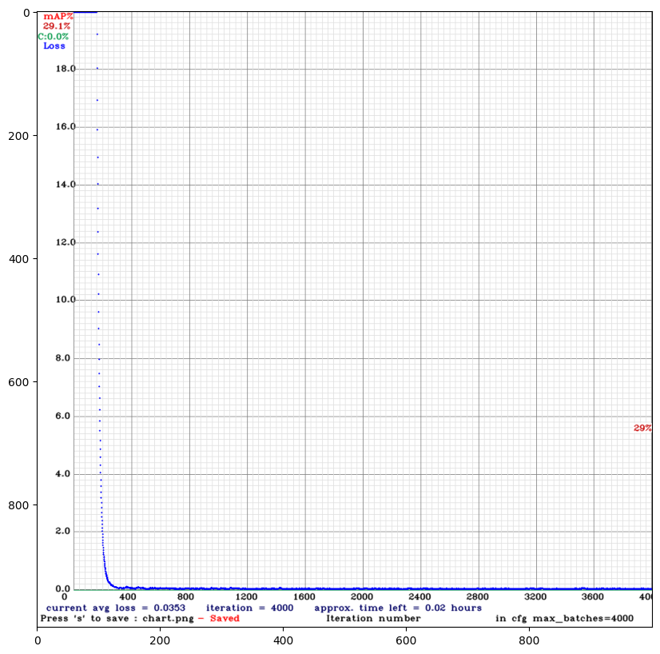

# Rede YOLO: dataset próprio e treino de detecção (pessoas e bicicletas)

*EN: custom YOLOv4-tiny training (Darknet, GPU on Google Colab) to detect people and bicycles, mAP@0.50 = 31%.*

Treino de um detector **YOLOv4-tiny** (Darknet) do zero, num subconjunto de um dataset público do Roboflow,
filtrado para duas classes: **pessoa** e **bicicleta**. Tudo roda no Google Colab com GPU.

## O que o notebook faz
1. Compila o Darknet com GPU, CUDNN e OpenCV.
2. Baixa o dataset (export público do Roboflow) e **filtra as anotações** para manter só `person` (0) e `bicycle` (1).
3. Treina 4.000 iterações, salvando os pesos no Google Drive (o treino continua de onde parou).
4. Avalia (mAP@0.50) e testa em imagens aleatórias de validação.
5. Ajusta a configuração (`max_batches` 4.000 → 6.000) e retoma o treino a partir dos melhores pesos.

## Resultado
| Etapa | mAP@0.50 |
|---|---|
| 4.000 iterações | 29,1% |
| 6.000 iterações | **31,0%** |

A perda cai rápido e estabiliza (≈0,035), mas o mAP fica baixo.

## O que aprendi
O dataset tinha muitas imagens sem as classes-alvo: o modelo passou mais tempo aprendendo o que **não** devia
do que pessoas e bicicletas. **Garbage in, garbage out**: a curadoria das imagens pesa mais que mais iterações.
Próximo passo: um dataset balanceado (só imagens com as duas classes) e aumento de dados.

## Como rodar
Abra `Yolo.ipynb` no Google Colab, ative a GPU (Ambiente de execução → Alterar tipo → GPU) e execute as células em
ordem. Os pesos são salvos em `MyDrive/yolo_darknet/backup`.

**Stack:** Darknet (YOLOv4-tiny), CUDA/cuDNN, OpenCV, Python, Google Colab.
